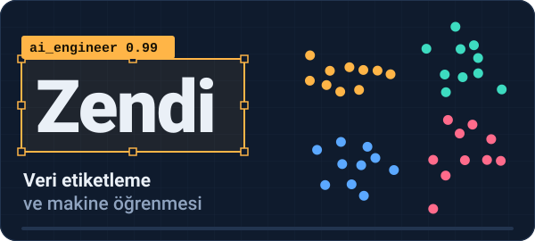
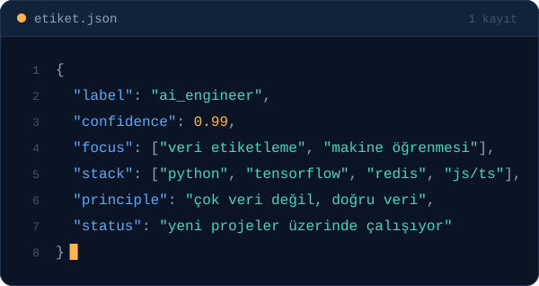

<p align="center">
  
</p>

<p align="center">
  <a href="https://github.com/zenndi">
    
  </a>
</p>

<p align="center">
  <a href="https://github.com/zenndi?tab=followers"></a>
  
  <a href="https://discord.com/users/1235350793222361281"></a>
</p>

<p align="center"></p>

<h3 align="center">Hakkımda</h3>

<p align="center">
  
</p>

Yapay zekâ ve makine öğrenmesi üzerine çalışıyorum. İyi bir modelin temeli temiz ve doğru etiketlenmiş veridir; bu yüzden veri hazırlamayı hızlandıran ve denetleyen araçlar yazmayı seviyorum. Arayüz tarafında framework kullanmadan, saf JavaScript ve Canvas ile çalışmayı tercih ediyorum.

> [!TIP]
> Bir proje fikrin ya da işbirliği teklifin varsa Discord’dan yazabilirsin.

<p align="center"></p>

<h3 align="center">Teknolojiler</h3>

<p align="center"><b>AI ve veri</b></p>
<p align="center">
  
  
  
</p>

<p align="center"><b>Web</b></p>
<p align="center">
  
  
  
  
</p>

<p align="center"><b>Araçlar</b></p>
<p align="center">
  
  
  
</p>

<p align="center"></p>

<h3 align="center">Çalışma akışım</h3>

<p align="center">
  
</p>

Ham veriden modele giden yolda her adımın kalitesi bir sonrakini belirler. Bu yüzden önce veriye, sonra modele bakarım.

<p align="center"></p>

<h3 align="center">Veri kalitesine bakışım</h3>

Etiket kalitesini sezgiyle değil ölçüyle değerlendirmeyi severim. İki etiketleyici arasındaki tutarlılığı, şansla beklenen uyumu çıkararak ölçen Cohen’s kappa buna iyi bir örnek:

```python
from collections import Counter


def cohen_kappa(a: list[str], b: list[str]) -> float:
    """İki etiketleyici arasındaki tutarlılığı, şansla beklenen uyumu çıkararak ölçer."""
    n = len(a)
    gozlenen = sum(x == y for x, y in zip(a, b)) / n
    ca, cb = Counter(a), Counter(b)
    beklenen = sum(ca[k] * cb[k] for k in ca.keys() | cb.keys()) / n**2
    return 1.0 if beklenen == 1 else (gozlenen - beklenen) / (1 - beklenen)


ali  = ["kedi", "köpek", "kedi", "kedi", "köpek", "kedi", "köpek", "kedi"]
veli = ["kedi", "köpek", "köpek", "kedi", "köpek", "kedi", "köpek", "kedi"]

print(round(cohen_kappa(ali, veli), 2))  # 0.75
```

Sekiz örnekten yedisinde iki etiketleyici aynı kararı vermiş, yani ham uyum %87,5. Şans payı çıkarılınca tutarlılık 0,75’e iniyor. Etiket kılavuzunun nerede netleşmesi gerektiğini böyle farklar gösterir.

<p align="center"></p>

<h3 align="center">Prensiplerim</h3>

| Prensip | Neden |
|---|---|
| **Çok veri değil, doğru veri.** | Yanlış etiket, modele yanlış bilgi öğretir. |
| **Otomatikleştir, ama sonucu doğrula.** | Betik hızlı çalışır; hatayı yakalamak yine de göz ister. |
| **Basit tut, sonra ölçekle.** | Küçük ve çalışan bir çözüm, büyük bir plandan iyidir. |

<p align="center"></p>

<h3 align="center">Projeler</h3>

> [!NOTE]
> Etiket verisindeki tutarsızlıkları yakalayan küçük bir Python aracı üzerinde çalışıyorum. Hazır olunca burada yer alacak.

<!-- Proje eklemek için bu satırı kullan:
- [**PROJE-ADI**](https://github.com/zenndi/PROJE-ADI): kısa açıklama

etiket-kontrol repo'su açılınca yukarıdaki notu silip bunu aç:
- [**etiket-kontrol**](https://github.com/zenndi/etiket-kontrol): Etiket verisindeki tutarsızlıkları bulan küçük Python aracı
-->

<p align="center"></p>

<h3 align="center">GitHub istatistikleri</h3>

<p align="center">
  
</p>

<p align="center"></p>

<h3 align="center">Bağlantılar</h3>

<p align="center">
  <a href="https://github.com/zenndi" target="_blank"></a>
  <a href="https://discord.com/users/1235350793222361281" target="_blank"></a>
</p>

<p align="center">
  
</p>
